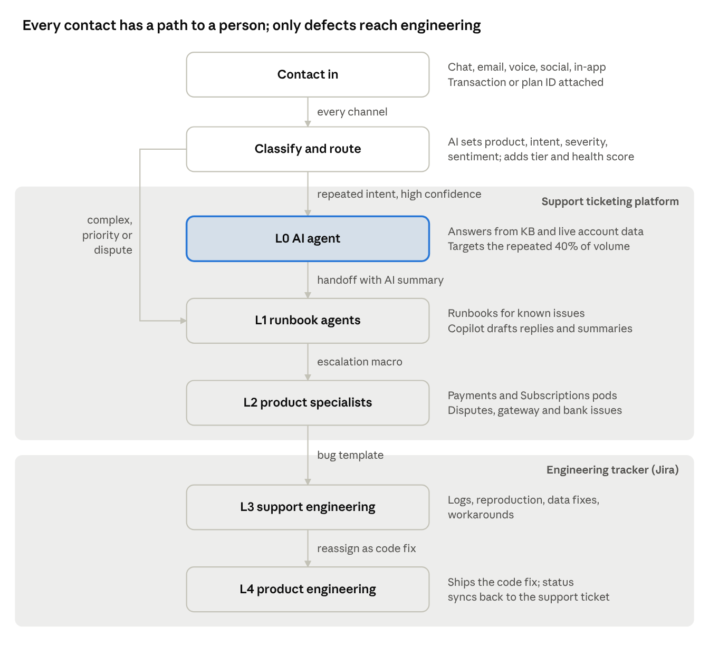

# AI-First Support Operations: SOP Pack

An end-to-end support operating model for an enterprise SaaS business, showing where AI removes cost and where humans stay in the loop. It covers two product lines (Payments: UPI, UPI QR, netbanking, cards; Subscriptions: 1-month, 6-month and 1-year plans) and two platform options (an in-house ticketing platform + Jira, or Zendesk + Jira).

**Core idea:** measure AI on *resolution*, not *deflection*. In an illustrative model of 50,000 contacts a month, a hybrid AI-plus-human design cuts support run cost by about 44% within six months (roughly $2.5M a year), in line with published research showing 30% to 53% savings for AI-led tier-one support.

## Contents

| File | What it is |
| --- | --- |
| [SOP.md](SOP.md) | The full SOP: operating model, seven SOPs with AI-touchpoint diagrams, escalation macros, real-time use cases, savings model, roadmap and risks |
| [Support_AI_Savings_Model.xlsx](Support_AI_Savings_Model.xlsx) | Formula-driven cost model; change the yellow inputs to your own numbers |
| [diagrams/](diagrams/) | One process-and-AI diagram per SOP, plus the tier flow |

## The seven SOPs

1. Intake, triage and routing
2. Tiered resolution (L0 AI agent to L4 engineering)
3. Escalation and human handoff (macro-driven)
4. Quality management and reopen root-cause analysis
5. Knowledge management
6. Customer health and churn prevention
7. Workforce management and governance

## Disclaimer

This is a first-cut reference design. Volumes, costs and savings are illustrative assumptions, and benchmark figures are vendor- or analyst-cited and directional. Regulatory timelines (for example UPI reversal turnaround times) should be confirmed against current RBI/NPCI guidance before use.
