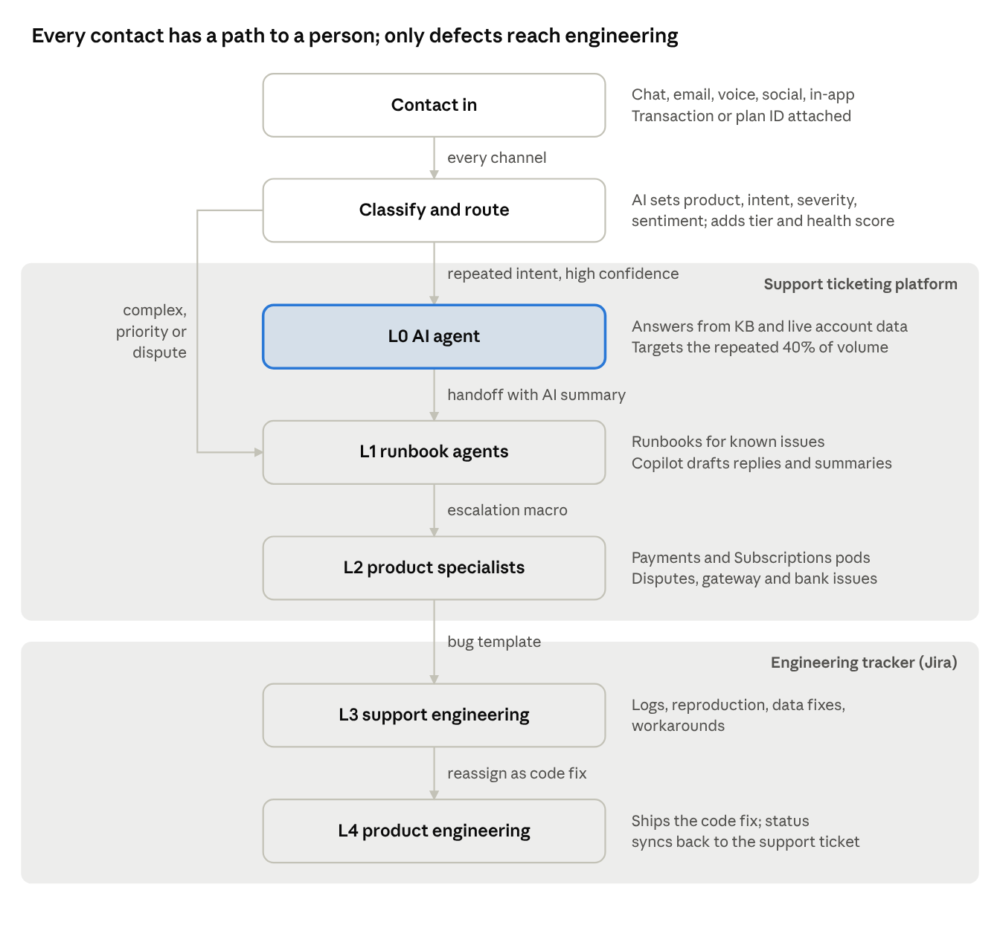
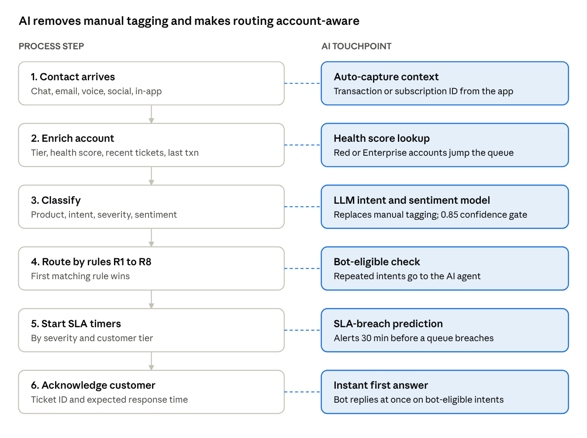
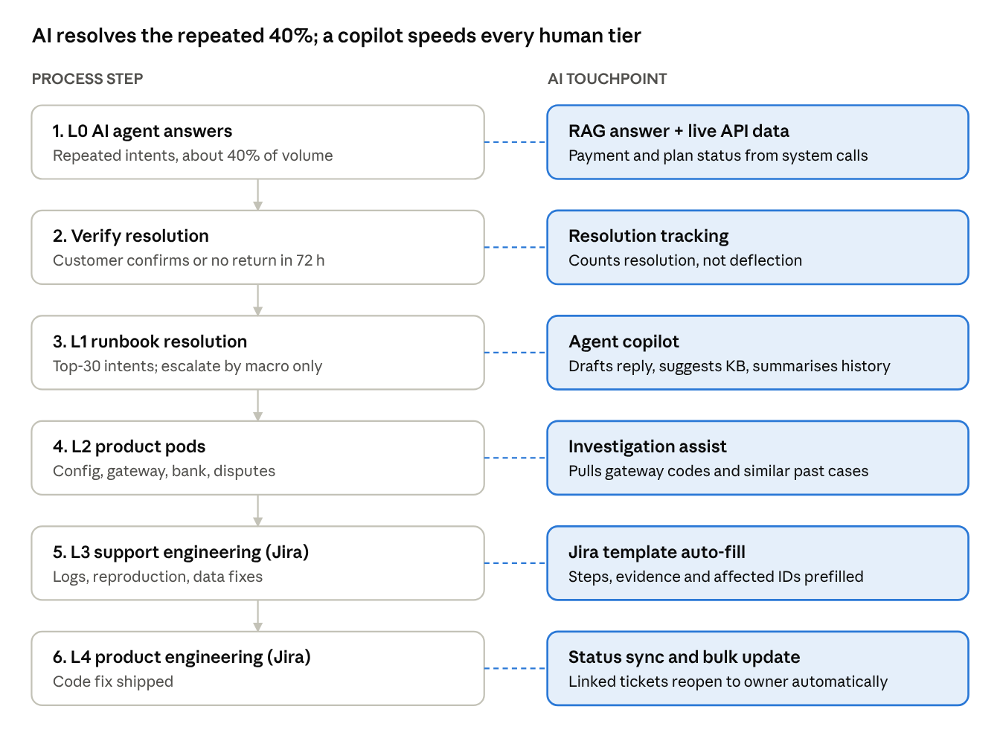
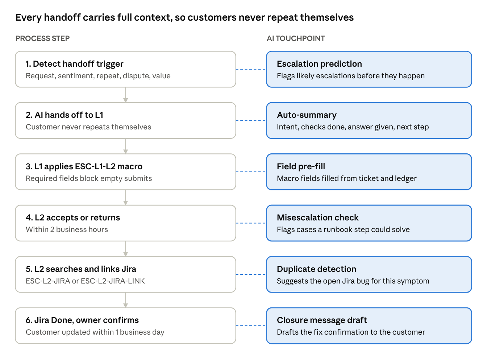
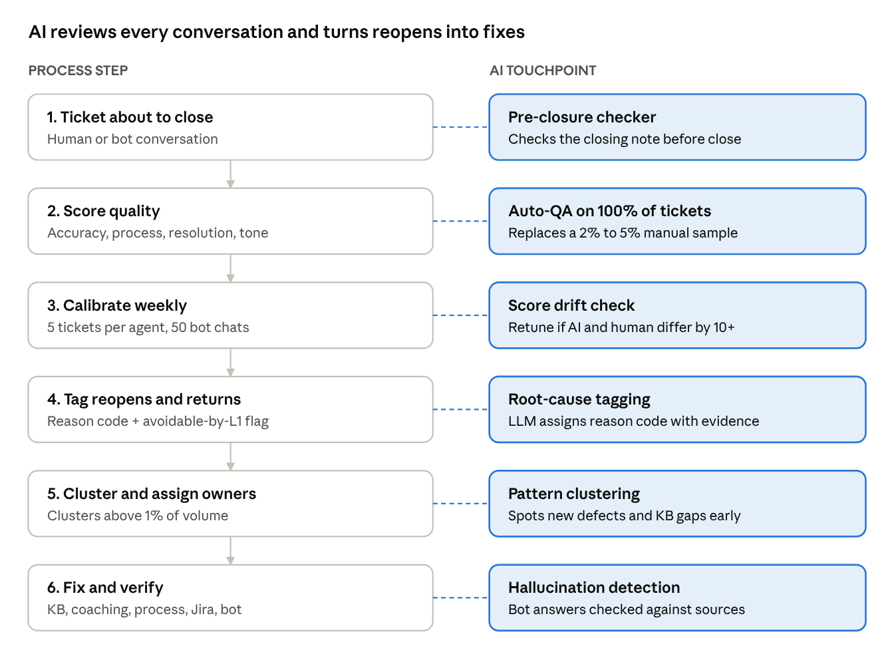
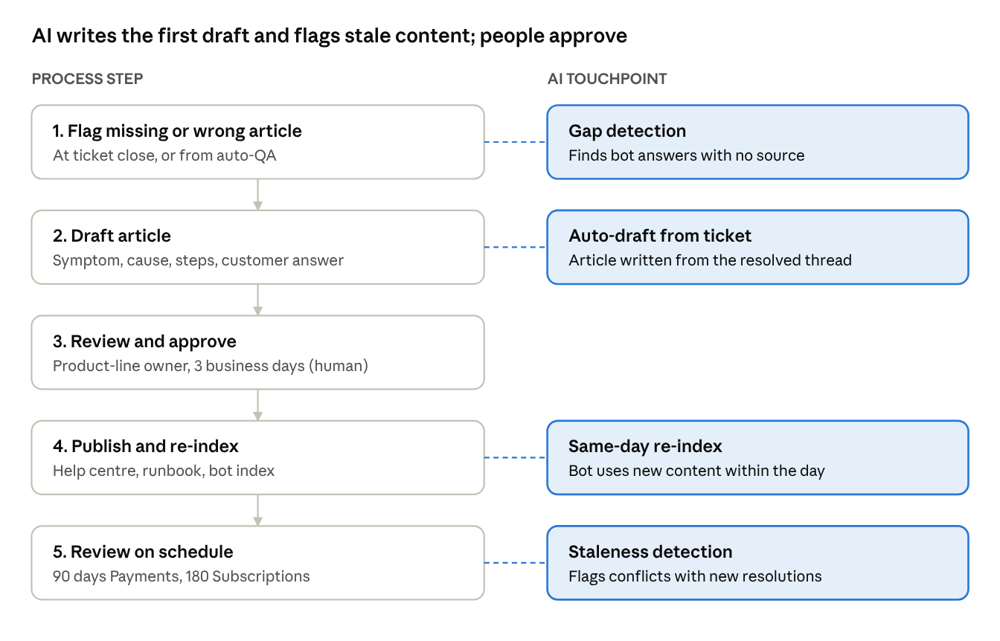
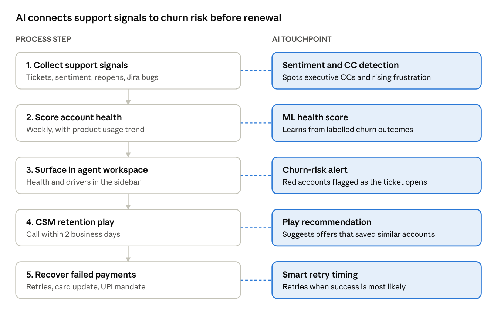
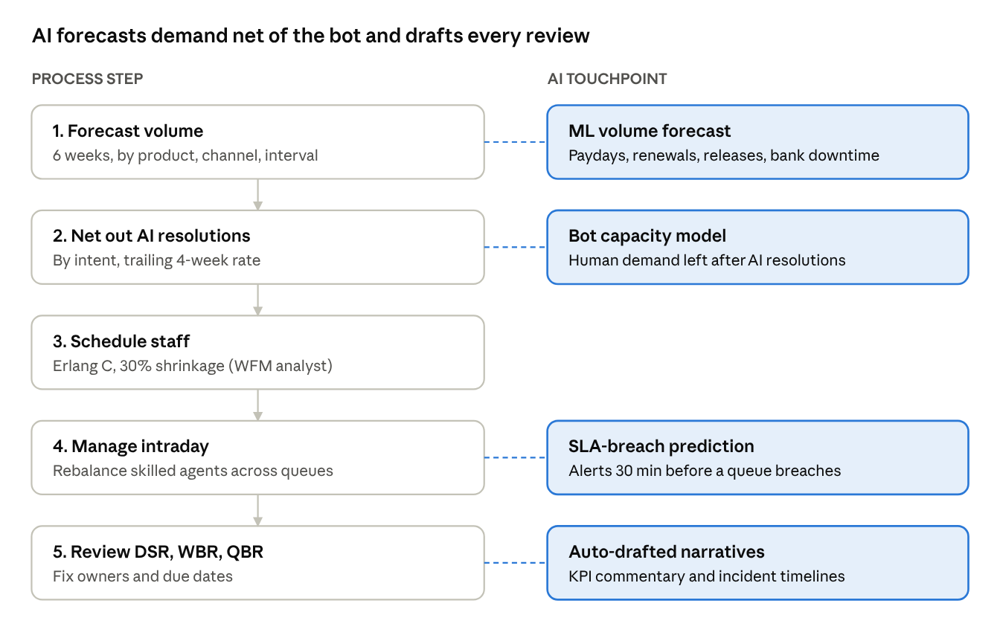

# Support Operations SOP Pack: AI-Optimised Support Org

Version 1.0 (first cut) · October 2026

## Executive summary

A hybrid AI-plus-human support model cuts monthly support run cost from about $477,500 to about $269,400 by month 6, a 44% reduction worth roughly $2.5M a year on an assumed 50,000 contacts a month. The savings come from resolution, not deflection: an AI agent resolves 70% of the repeated-intent 40% of volume, a copilot shortens human handling, and tighter routing cuts L1 to L2 transfers. Every figure is directional and rests on the assumptions in the savings model section, which should be replaced with real operating data.

**Scope.** Seven SOPs cover the full ticket lifecycle from contact creation to routing, resolution, escalation to engineering, quality, knowledge and governance. Each SOP is written once and shows where the two platform options differ.

| Item | Covered in this pack |
| --- | --- |
| Platform models | Model A: in-house ticketing platform + Jira for L3/L4. Model B: Zendesk + Jira for L3/L4 |
| Product lines | Payments (UPI, netbanking, credit/debit card, UPI QR). Subscriptions (Pro 1 month, Max 6 months, Grand 1 year) |
| Tiers | L0 AI agent + KB, L1 runbook agents, L2 product specialists, L3 support engineering, L4 product engineering |
| Escalation | Macro-driven L1 to L2 and L2 to Jira, with mandatory context fields |
| AI levers | Intent and sentiment classification, AI agent, agent-assist copilot, 100% auto-QA, KB auto-drafting, health scoring, volume forecasting |

**Design rules carried through every SOP.**

1. Measure AI resolution rate, not deflection rate. A deflected contact that comes back as a reopen or a repeat contact is a cost, not a saving.
2. Every customer can reach a human in one step. Klarna's reversal after an AI-first rollout is the cautionary case.
3. Ground every AI answer in the client's own KB (retrieval-augmented generation), with a confidence threshold that hands off below it.
4. Payments disputes, refunds and regulatory complaints always go to a human.

One-page versions of each SOP (Purpose, Scope, RACI, Steps, AI touchpoints, KPIs): SOP one-pagers

## Operating model

Both models run the same tiers, queues and rules; they differ only in where the ticket lives before it reaches engineering and in what is built versus bought. Jira is the system of record for every L3/L4 code fix and bug in both models.

### Platform options

| Capability | Model A: In-house platform + Jira | Model B: Zendesk + Jira |
| --- | --- | --- |
| Ticket system for L0 to L2 | In-house platform | Zendesk Suite |
| Channels | Chat, email, in-app, voice via in-house connectors; social via an aggregator | Zendesk Messaging, Email, Talk, Social; in-app via Zendesk SDK |
| Routing engine | In-house rules service + skills table (built) | Omnichannel routing, skills, triggers (configured) |
| Macros | In-house macro library (built: field updates, status, group, private note) | Native macros |
| SLA timers | In-house SLA service (built) | Native SLA policies |
| AI agent (L0) | Client LLM stack with RAG on the KB, or third-party bot via API | Zendesk AI agents, or a third-party bot via the Sunshine API |
| Agent copilot | Built into the in-house agent sidebar | Zendesk Copilot / agent workspace apps |
| Auto-QA | Third-party QA tool via API, or built | Zendesk QA |
| Jira link | Custom in-house-to-Jira connector (two-way status and comment sync) | Zendesk Support for Jira integration (native, two-way) |
| Licence profile | No per-seat fee; build and run cost sits with client engineering | Per-agent licence plus per-automated-resolution AI fee |
| Best fit | Client wants full data control and has platform engineering capacity | Client wants speed to launch and vendor-maintained AI |

### Tiers

| Tier | Who | Owns | Exit path |
| --- | --- | --- | --- |
| L0 | AI agent + help centre | Repeated intents: payment status, refund status, plan details, invoices, renewals, how-to | Resolved, or handoff to L1 with summary |
| L1 | Frontline agents (vendor or in-house) | Known issues on runbooks, account and billing actions within limits | Resolved, or L2 macro |
| L2 | Product specialists per line | Config, integration, gateway and bank-side issues, disputes, complex billing | Resolved, or Jira via L3 macro |
| L3 | Support engineering | Log analysis, reproduction, data fixes, workarounds | Resolved, or Jira bug/code-fix to L4 |
| L4 | Product engineering | Code fixes and releases | Fix shipped, linked tickets closed |

### Product and intent taxonomy

Every ticket carries three routing fields: product line, product, and intent. Intents marked bot-eligible form the repeated 40% the AI agent targets.

| Product line | Product | Top intents | Bot-eligible | Default owner |
| --- | --- | --- | --- | --- |
| Payments | UPI | Payment debited but not credited, pending status, refund status, UPI PIN or app errors | Status and refund lookups | L1 Payments |
| Payments | UPI QR | QR not scanning, merchant QR settlement, wrong amount | How-to, settlement status | L1 Payments |
| Payments | Netbanking | Bank page timeout, double debit, bank not listed | Status lookups, bank list | L1 Payments |
| Payments | Credit/debit card | Decline reasons, OTP/3DS failure, chargeback, refund timeline | Decline explainers, refund status | L1 Payments; chargebacks L2 |
| Subscriptions | Pro (1 month) | Plan features, renewal failure, cancel, upgrade | Plan info, invoices, cancel flow | L1 Billing |
| Subscriptions | Max (6 months) | Proration on upgrade or downgrade, mid-term refund | Plan info, proration explainer | L1 Billing; refunds L2 |
| Subscriptions | Grand (1 year) | Annual renewal, refund window, invoice and tax | Invoices, renewal date | L1 Billing; refunds and enterprise contracts L2 |

A contact moves down one tier at a time through a macro, and a customer can leave the AI agent for a person at any point. Contacts that are not bot-eligible, or that hit a priority or dispute rule, go straight to L1 or L2.

## SOP 1: Intake, triage and routing

Every inbound contact is classified by product line, product, intent, severity and customer tier within 60 seconds of creation, then placed in one queue with an SLA timer. An LLM classifier replaces manual tagging; agents only correct it.

**Owner:** Support Operations (routing rules), WFM (queue staffing). **Systems:** In-house rules service (Model A) or Zendesk triggers and omnichannel routing (Model B).

### Procedure

1. **Create.** Contact arrives on chat, email, voice, social or in-app. The ticket is created with requester, account ID, channel and, for in-app, the transaction ID or subscription ID passed from the app.
2. **Enrich.** The system pulls customer tier (Enterprise, Mid-market, SMB, Consumer), health score, open tickets in the last 7 days, and the last transaction status from the payments ledger.
3. **Classify.** The AI classifier sets product line, product, intent, sentiment (positive, neutral, negative, angry), language and a confidence score.
   - Confidence 0.85 or higher: fields are set and locked for routing.
   - Confidence below 0.85: ticket goes to the Triage queue, where an L1 triage agent sets the fields within 15 minutes.
4. **Set severity** using the matrix below.
5. **Route** using the routing rules below, in order. The first rule that matches wins.
6. **Start SLA timers** for first response and resolution, per severity and tier.
7. **Auto-acknowledge** with the ticket ID, expected response time and, for bot-eligible intents, the AI agent's first answer.

### Severity matrix

| Severity | Definition | Examples | First response (Enterprise / others) | Resolution target |
| --- | --- | --- | --- | --- |
| Sev 1 | Platform-wide outage or money at risk for many customers | UPI success rate drops sharply, card gateway down, mass double debits | 15 min / 30 min | Workaround in 4 h |
| Sev 2 | One customer's money or access blocked | Debited but not credited, subscription active but features locked | 1 h / 2 h | 24 h |
| Sev 3 | Function impaired, workaround exists | QR scan failure on one device, invoice wrong | 4 h / 8 h | 3 business days |
| Sev 4 | Question or request | Plan comparison, how to cancel, refund timeline | 8 h / 24 h | 5 business days |

### Routing rules (evaluated top to bottom)

| # | Condition | Route to | Notes |
| --- | --- | --- | --- |
| R1 | Sev 1 or incident tag active | Incident queue + page on-call L3 | Bulk-link to the incident's parent ticket |
| R2 | Regulatory, legal, RBI/NPCI complaint, fraud or chargeback keywords | L2 Payments Disputes | Never bot-handled |
| R3 | Enterprise tier, or health score red | L1 Priority queue (skips bot unless customer chose self-serve) | Health drivers shown in the agent sidebar |
| R4 | Bot-eligible intent and confidence 0.85 or higher | L0 AI agent | Handoff rules in SOP 3 |
| R5 | Product line = Payments | L1 Payments queue, skill by product (UPI, QR, netbanking, cards) |  |
| R6 | Product line = Subscriptions | L1 Billing queue, skill by plan (Pro, Max, Grand) |  |
| R7 | Third contact on the same issue in 7 days | L1 Priority queue, repeat-contact flag | Counts toward SOP 3 trigger |
| R8 | No match | Triage queue | Reviewed daily to add rules |

### Platform build notes

- **Model A (in-house):** routing rules live in the rules service as ordered conditions; the classifier writes to custom fields through the ticket API. Build a rule-change audit log because there is no vendor change history.
- **Model B (Zendesk):** classifier writes to custom ticket fields via the API or Zendesk's intelligent triage; triggers set group and priority; omnichannel routing assigns by skill. Keep triggers in the same R1 to R8 order and prefix their names with the rule number.

### How AI optimises this SOP

The left lane is the procedure; each shaded box on the right is the AI that removes manual effort or delay from that step.

| Step | Manual today | With AI | Effect |
| --- | --- | --- | --- |
| Contact arrives | Agent asks for transaction or subscription ID | App passes the ID with the ticket | One less customer exchange per payment ticket |
| Enrich account | Agent looks up tier and history in separate tools | Tier, health and last transaction attached automatically | At-risk and Enterprise accounts prioritised from the first second |
| Classify | Agent picks product, intent and severity from dropdowns | LLM classifier sets fields; agents only correct low-confidence ones | Misroute rate target under 5%; tagging time removed |
| Route | Static queue by channel | Rules R1 to R8 use AI fields; repeated intents go to the bot | Bot takes the repeated 40% before a human sees it |
| SLA timers | Breaches found in end-of-day reports | Breach predicted 30 minutes ahead | WFM moves agents before the breach |
| Acknowledge | Generic auto-reply | AI first answer for bot-eligible intents | Many contacts resolved in the first minute |

### KPIs

| KPI | Definition | Target |
| --- | --- | --- |
| Misroute rate | Tickets moved to another queue by a human after routing | Under 5% |
| Classifier accuracy | Auto-set fields not changed by an agent | 90% or higher |
| First response time | Median, by severity and tier | Within the matrix above, 95% of tickets |
| L1 to L2 transfer rate | L1 tickets escalated by L2 macro | Under 18% |

## SOP 2: Tiered resolution (L0 to L4)

The AI agent owns the repeated 40% of volume and is held to a verified resolution target of 40% of those contacts at launch, rising to 70% by month 6. Human tiers use runbooks and a copilot, and only reproducible defects reach Jira.

### L0: AI agent and self-service

1. The AI agent answers only from the client's KB, runbooks and live account data (transaction status, refund status, plan and renewal date). No answer is generated without a retrieved source.
2. For payment status intents it calls the payments API with the transaction ID or UTR, states the status, and gives the documented timeline (for example the bank's refund window).
3. For subscription intents it can show plan details, send invoices, explain proration, and run cancel or downgrade flows that need no refund approval.
4. It offers "talk to a person" in every conversation and hands off at once when asked.
5. A contact counts as **resolved by AI** only when the customer confirms or does not return on the same intent within 72 hours.
6. Weekly tuning: review the 50 lowest-scored bot conversations, fix KB gaps, add or adjust intents.

### L1: Runbook resolution

1. Agent opens the ticket with the copilot summary, suggested KB articles and a draft reply already in the sidebar.
2. Agent follows the intent's runbook. Every top-30 intent has one, with the checks, the allowed actions and the macro to close or escalate.
3. Allowed L1 actions: resend invoice, retry failed renewal, apply goodwill credit up to the client-set limit, raise a refund for an auto-reversal that missed its window, reset subscription entitlements.
4. If the runbook ends without resolution, apply the L2 escalation macro (SOP 3). No free-text escalation.

### L2: Product specialists

1. Separate L2 pods for Payments (UPI and QR, netbanking, cards and chargebacks) and Subscriptions (plans, refunds, enterprise contracts).
2. L2 investigates gateway, bank and NPCI responses, merchant configuration and integration errors, and handles disputes and refunds above L1 limits.
3. If the issue is a product defect or needs a data fix, apply the Jira macro (SOP 3), which creates the Jira issue from the template and links it.

### L3 and L4: Engineering via Jira

| Field in the Jira template | Content |
| --- | --- |
| Summary | Product, intent, symptom in one line |
| Issue type | Bug, Data fix, or Code change request |
| Priority | Mapped from ticket severity (Sev 1 = Highest) |
| Customers affected | Count and linked support ticket IDs |
| Steps to reproduce | Exact steps, app version, device, bank or card network |
| Evidence | Transaction IDs, UTR, gateway response codes, logs, screenshots |
| Workaround given | What the customer was told |
| Support owner | L2 agent who keeps the customer updated |

L3 support engineering triages within 4 business hours: resolves data fixes and workarounds itself, or reassigns to the L4 product team's Jira board. Jira status changes sync back to the support ticket (native in Model B, via the built connector in Model A), and the L2 owner updates the customer at each change.

### Benchmarks: deflection versus resolution

Deflection counts a contact that did not reach a human; it rises when the bot simply blocks people. The client is measured on resolution. Figures below are directional and largely vendor-sourced.

| Metric | Definition | Industry range | Target here |
| --- | --- | --- | --- |
| Self-service deflection | Contacts that end in self-service without a ticket | About 20% to 40% | Report only, not a goal |
| AI resolution rate (all volume) | Verified resolutions by AI ÷ all contacts | 22.4% bottom quartile, 58.7% top quartile (vendor data) | 16% launch, 28% month 6 |
| AI resolution rate (bot-eligible intents) | Verified AI resolutions ÷ bot-eligible contacts | About 40% at launch to 70%+ by month 6 with weekly tuning | 40% launch, 70% month 6 |
| First contact resolution | Resolved with no reopen or repeat in 7 days | About 70% to 75% | 75% |
| Reopen rate | Solved tickets reopened within 7 days | Under 5% | Under 4% |
| CSAT | Satisfied responses ÷ responses | About 75% to 85% | 85%, and AI CSAT within 3 points of human CSAT |

### How AI optimises this SOP

The AI agent takes whole contacts off the human queue; at every human tier the copilot shortens handling instead of replacing the agent.

| Step | Manual today | With AI | Effect |
| --- | --- | --- | --- |
| L0 answer | Static FAQ or a scripted bot that cannot see account data | AI agent answers from the KB and calls payment and subscription APIs | 40% of bot-eligible contacts resolved at launch, 70% by month 6 |
| Verify | Bot success counted as "conversation ended" | Resolution counted only after confirmation or 72 hours without return | Savings figures reflect real resolution |
| L1 | Agent reads history and searches the KB by hand | Copilot summary, suggested article and drafted reply in the sidebar | L1 AHT down about 20% (model assumption) |
| L2 | Agent collects gateway logs and past cases manually | Copilot pulls response codes, ledger entries and similar resolved cases | L2 AHT down about 15%; fewer returns to L1 |
| L3 | Engineer chases missing reproduction details | Jira template prefilled from the ticket and cluster | Faster triage within the 4-hour target |
| L4 and closure | Agents check Jira by hand for fixes | Jira Done reopens linked tickets and drafts customer updates | No missed confirmations after a fix |

### KPIs

AI resolution rate, FCR, AHT by tier, cost per resolution, Jira escalation rate (target under 2% of all contacts), Jira time to fix by priority.

## SOP 3: Escalation and human handoff

Every move between tiers happens through a macro that forces the context fields, so the next tier never asks the customer to repeat anything. The same macro names and fields exist in the in-house platform and Zendesk.

### When the AI agent must hand off to L1

| Trigger | Detection | Handoff target |
| --- | --- | --- |
| Customer asks for a person | Intent "human" or keywords, any language | L1 queue for that product, immediately |
| Negative or angry sentiment | Sentiment model, two consecutive negative turns | L1 Priority |
| Repeat contact | Same intent 2 or more times in 7 days | L1 Priority |
| Money dispute or regulatory mention | Refund dispute, chargeback, fraud, RBI, ombudsman, legal | L2 Payments Disputes |
| High-value account | Enterprise tier or health score red | L1 Priority |
| Low confidence | Retrieval confidence below threshold, or two failed answers | L1 product queue |
| Escalation predicted | Model predicts escalation probability above 0.6 | L1 product queue |

On handoff the AI writes a private note: intent, what the customer asked, what was checked (transaction or subscription data), what was answered, sentiment, and the suggested next step.

### Escalation macros

| Macro | Used by | Required fields (macro blocks submit if empty) | What it does |
| --- | --- | --- | --- |
| ESC-L1-L2-PAY | L1 Payments | Transaction ID or UTR, payment method, bank or card network, amount, debit timestamp, runbook step reached, customer impact | Sets group to L2 Payments pod, priority from severity, status Open, adds private note template, sends customer holding reply with next update time |
| ESC-L1-L2-SUB | L1 Billing | Subscription ID, plan (Pro, Max, Grand), billing date, amount, action requested, runbook step reached | Sets group to L2 Subscriptions pod, same as above |
| ESC-L1-L2-DISPUTE | L1 any | Dispute type, amount, evidence attached | Sets L2 Disputes group, tags regulatory, starts dispute SLA |
| ESC-L2-JIRA | L2 | All Jira template fields (SOP 2), reproduction confirmed yes/no | Creates and links a Jira issue, sets ticket status On-hold, sends customer update, starts Jira-linked SLA |
| ESC-L2-JIRA-LINK | L2 | Existing Jira key | Links the ticket to an open Jira bug and increments the customers-affected count instead of creating a duplicate |
| DE-ESC-RETURN | L2 or L3 | Reason for return, what L1 missed | Returns to L1 with coaching tag; counts as a misescalation in QA |
| ESC-MGMT | Any | Account, reason, requested by | Flags executive or management involvement; notifies the account's CSM (SOP 6) |

### Rules

1. L1 may escalate only after the runbook's last step, or immediately for Sev 1 and Sev 2 and disputes.
2. L2 accepts or returns an escalation within 2 business hours. Returns use DE-ESC-RETURN, never a reassign.
3. L2 searches Jira for an open bug on the same symptom before creating one, and links with ESC-L2-JIRA-LINK when it exists.
4. The ticket's support owner stays at L2 while Jira is open. Engineering never replies to customers directly.
5. When the linked Jira issue moves to Done, the ticket reopens to its owner, who confirms the fix with the customer within 1 business day.

### Platform build notes

- **Model A:** build the macros in the in-house platform as field-validation forms; the Jira macro calls the Jira REST API to create the issue and stores the key on the ticket. The two-way sync job posts Jira status and public comments into the ticket's internal notes.
- **Model B:** create the macros natively; use required ticket fields per form to enforce context, and the Zendesk Support for Jira integration to create, link and sync issues.

### How AI optimises this SOP

AI decides when a handoff is needed and writes the context, so each tier starts where the last one stopped.

| Step | Manual today | With AI | Effect |
| --- | --- | --- | --- |
| Detect trigger | Customer must ask several times for a person | Sentiment, repeat-contact and escalation-risk models trigger the handoff | Fewer angry repeat contacts; protects post-handoff CSAT |
| Handoff to L1 | Agent re-reads the bot transcript or re-asks the customer | Five-line AI summary as a private note | Saves about 1 to 2 minutes per handed-off contact (directional) |
| L1 to L2 macro | Free-text escalation, details missing | Macro fields prefilled from ticket and ledger; empty fields block submit | Misescalation target under 10% |
| L2 accept or return | Returns argued over chat | AI flags escalations a runbook step would have solved | Coaching targeted at real gaps |
| Jira | Duplicate bugs raised by several agents | AI suggests the open Jira key for the same symptom | Lower Jira duplicate rate; engineering sees true impact count |
| Closure | Agents watch Jira manually | Jira Done reopens ticket with drafted customer update | Fix confirmed within 1 business day |

### KPIs

Escalation rate by tier, misescalation rate (returns ÷ escalations, target under 10%), post-handoff CSAT, repeat contact rate, Jira duplicate rate.

## SOP 4: Quality management and reopen RCA loop

AI scores 100% of human and bot conversations against one rubric, humans calibrate on a weekly sample, and every reopen and escalation gets a root-cause tag that feeds a fix owner. This replaces the usual 2% to 5% manual sample.

### QA rubric (applies to human and AI answers)

| Dimension | Weight | Pass standard |
| --- | --- | --- |
| Accuracy | 35% | Answer matches KB or system data; correct amounts, dates, timelines |
| Process adherence | 25% | Runbook followed, correct macro, required fields complete |
| Resolution | 20% | Issue solved or correctly escalated in one touch |
| Empathy and tone | 10% | Acknowledges impact, plain language, no blame |
| Documentation | 10% | Internal note lets the next person act without asking |

Auto-fail: wrong refund or payment status given, PII or card data in a reply, missed regulatory escalation.

### Procedure

1. **Daily:** auto-QA scores every closed ticket and bot conversation. Scores under 70% and every auto-fail go to the team lead's review queue.
2. **Weekly calibration:** QA analysts score a sample of 5 tickets per agent plus 50 bot conversations by hand. If AI and human scores differ by more than 10 points on a dimension, retune the scoring prompt.
3. **Reopen RCA:** every reopened ticket and every DE-ESC-RETURN gets one root-cause code from a standard reopen reason-code set (INCOMPLETE\_FIX, NO\_ROOT\_CAUSE, WRONG\_MODULE\_OR\_DIAGNOSIS, CLOSED\_WITHOUT\_CONFIRMATION, POOR\_COMMUNICATION, RECURRENCE, NEW\_ISSUE\_SAME\_TICKET, CUSTOMER\_MISUNDERSTANDING, PENDING\_L2\_OR\_PRODUCT, OTHER), plus three added for this design: KB\_GAP, BANK\_OR\_GATEWAY\_SIDE and BOT\_HALLUCINATION. Each tag also records whether L1 could have avoided it.
4. **Clustering:** AI groups reopen and escalation notes weekly and proposes new tags when a cluster has no fitting one.
5. **Fix routing:** KB gap or KB wrong goes to Knowledge (SOP 5), agent error to coaching, process gap to Support Ops, product defect to Jira, bot hallucination to the AI owner for prompt and retrieval fixes.
6. **Close the loop:** each tag cluster above 1% of volume gets an owner and a due date in the weekly business review (SOP 7).

**Pre-closure checker.** Before an L1 or L2 agent closes a ticket, an advisory AI check reviews the closing note against six points: answers the ask, states what was done, gives a cause, asks for confirmation, names open items, and uses clear language. It returns READY TO CLOSE or NEEDS WORK with a suggested rewrite. It targets a 10% to 15% relative cut in reopens.

### AI guardrails

- Grounding: answers come only from retrieved KB and account data. Uncontrolled LLMs show hallucination rates of 15% to 20% in one vendor compilation versus 2% to 5% with retrieval, so retrieval is mandatory.
- Every bot answer with a refund amount, date or status must come from a system call, never from generated text.
- Bot hallucinations found in QA are a Sev 3 defect against the AI configuration, fixed within 5 business days.

### How AI optimises this SOP

QA moves from sampling after the fact to checking every ticket, with people calibrating the AI rather than scoring by hand.

| Step | Manual today | With AI | Effect |
| --- | --- | --- | --- |
| Before close | No check; weak closing notes cause reopens | Pre-closure checker returns READY TO CLOSE or NEEDS WORK | 10% to 15% relative reopen reduction (target) |
| Score | 2% to 5% of tickets audited | 100% scored against the rubric | Every auto-fail found the same day |
| Calibrate | Auditors disagree on tags | Weekly human sample checks AI scoring | Consistent scores; drift caught within a week |
| Tag reopens | Manual, inconsistent, weeks late | LLM tags each reopen with a reason code and evidence | 100% coverage; insight within a week |
| Cluster | Patterns noticed only when volume spikes | AI clusters tags and notes weekly, and flags new ones daily | Defects like use case 5 spotted in hours |
| Fix | Findings sit in a report | Each cluster routed to an owner with a due date | Knowledge-gap closure within 10 business days |

### KPIs

QA score by agent and by bot, auto-QA coverage (target 100%), reopen rate (target under 4%), share of reopens with a root-cause tag (target 100%), knowledge-gap closure time (target 10 business days).

## SOP 5: Knowledge management

Every novel issue resolved at L1 or above becomes a KB article or runbook update within 5 business days, and every article has a named owner and a review date. The KB is the AI agent's only source, so its hygiene caps the bot's resolution rate.

### Procedure

1. **Flag:** when closing a ticket, the agent marks "no article existed" or "article was wrong". Auto-QA also flags answers that had no retrieved source.
2. **Draft:** AI drafts an article from the resolved ticket thread: symptom, cause, steps, customer-facing answer, internal notes, and which intent it serves.
3. **Review:** the product-line knowledge owner (Payments or Subscriptions) edits and approves within 3 business days. Payments refund timelines and regulatory text need L2 lead sign-off.
4. **Publish:** to the internal runbook, the public help centre, or both, and re-index for the AI agent the same day.
5. **Expire:** each article has a review date, 90 days for Payments and 180 days for Subscriptions. AI flags articles whose answers conflict with recent ticket resolutions or product release notes.
6. **Retire:** articles with no views or retrievals in 180 days are archived.

### Article standard

| Field | Rule |
| --- | --- |
| Title | The customer's question in their words |
| Product and intent | From the taxonomy, so routing and the bot can find it |
| Answer | First two lines answer the question |
| Steps | Numbered, one action each |
| Escalation | Which macro to use when the steps fail |
| Owner and review date | Required to publish |

### Platform notes

- **Model A:** host the KB in a CMS or the in-house knowledge module; the AI agent's retrieval index reads from it.
- **Model B:** Zendesk Guide is the KB and feeds Zendesk AI agents and Copilot directly.

### How AI optimises this SOP

Approval stays human because the bot repeats whatever the KB says; AI removes the writing and the hunting for stale content.

| Step | Manual today | With AI | Effect |
| --- | --- | --- | --- |
| Flag gap | Gaps found only when agents complain | Unsourced bot answers and "no article" flags collected automatically | Gap list ready for every WBR |
| Draft | Writer starts from a blank page | AI drafts from the resolved ticket thread | Article live within 5 business days |
| Approve | Same | Owner edits and approves | Accuracy stays with the product-line owner |
| Publish | Bot index refreshed weekly or by hand | Re-index on publish | New answers reach the bot the same day |
| Review | Calendar reminders, often missed | AI compares articles with recent resolutions and release notes | Stale answers fixed before they cause reopens |

### KPIs

Articles created from tickets per month, share of AI answers with a cited article, stale article count, knowledge-gap closure time, AI resolution rate by intent.

## SOP 6: Customer health and churn prevention

Support signals feed a per-account health score, and a red score triggers a defined Customer Success play within 2 business days. Failed subscription payments get their own recovery play, because involuntary churn from payment failures makes up 20% to 40% of SaaS churn and is the cheapest to fix.

### Health score inputs from support

| Signal | Why it matters | Weight (starting point) |
| --- | --- | --- |
| Ticket volume trend, 30 days versus prior 90 | Rising friction | 20% |
| Negative sentiment share | Frustration | 15% |
| Reopens and escalations per account | Unresolved problems | 15% |
| Open Sev 1 or Sev 2 tickets, or Jira bugs affecting the account | Product blocking value | 15% |
| Management or executive CC, or ESC-MGMT macro used | Behaviour shift before churn | 15% |
| Product usage trend (from product analytics) | Declining usage plus rising tickets is the strongest signal | 20% |

An ML model replaces these starting weights once 6 months of churn outcomes are labelled.

### Plays

| Trigger | Owner | Play |
| --- | --- | --- |
| Health turns red | CSM | Call within 2 business days, review open tickets and Jira issues, agree a fix plan |
| Enterprise account opens a ticket while red | L1 Priority agent | Health score and its drivers shown in the sidebar; agent tags CSM on the ticket |
| Max or Grand renewal within 30 days and health amber or red | CSM + Billing L2 | Renewal save call; review proration or upgrade options |
| Subscription payment fails | Billing automation | Smart retry schedule, in-app and email card-update prompt, UPI autopay mandate re-auth link, then L1 Billing outreach on the third failure |
| Cancel intent in bot or ticket | AI agent, then L1 Billing | Ask reason, offer the documented retention option (downgrade from Grand or Max to Pro, pause), then process the cancel if declined |

### Support-to-CS reporting

Roll up reopen and escalation root-cause tags per customer account each month and share them with the client's CS team. This links L1 quality data to churn risk, a stronger QBR story than throughput alone.

### How AI optimises this SOP

Support data becomes an early-warning feed for Customer Success instead of a throughput report.

| Step | Manual today | With AI | Effect |
| --- | --- | --- | --- |
| Collect signals | Ticket data stays in the support tool | Sentiment, executive CCs, reopens and Jira links rolled up per account | CS sees friction weeks before renewal |
| Score | Rule-based score, refreshed quarterly | ML score weekly, combining usage decline with ticket trend | Catches the strongest churn signal rule-based scores miss |
| Surface | Agent unaware the account is at risk | Health and drivers shown when a red account opens a ticket | Agent adjusts tone and tags the CSM (use case 3) |
| Retention play | Ad hoc outreach | Offer suggested from similar saved accounts | Higher at-risk save rate |
| Failed payments | Fixed retry schedule | Retry timed to likely success; card and UPI mandate prompts | Cuts involuntary churn, often the cheapest churn to fix |

### KPIs

Gross and net revenue retention, at-risk save rate, involuntary churn rate, failed-payment recovery rate, time from red flag to CSM contact.

## SOP 7: Workforce management and governance cadence

Volume is forecast by product line, channel and half-hour interval, staffing is set from that forecast at each tier, and a fixed review cadence holds every SOP's KPIs to account. AI produces the forecast, the live SLA-breach alerts and the first draft of every review narrative.

### Forecasting and scheduling

1. **Forecast** weekly for the next 6 weeks, by product line, channel and interval. Inputs: history, payday and month-end peaks, bank holidays, planned releases, subscription renewal dates (Pro monthly, Max and Grand cohorts), and known bank or UPI downtime.
2. **Net out AI:** subtract the expected AI resolutions by intent, using the trailing 4-week AI resolution rate, before computing human staffing.
3. **Staff** with Erlang C for chat and voice and a workload model for email, at the service-level targets in SOP 1, with shrinkage at 30% as a starting assumption.
4. **Intraday:** real-time alerts when a queue is projected to breach SLA within 30 minutes; the WFM analyst moves skilled agents between queues.
5. **Incidents:** on a Sev 1, WFM opens an overflow plan and the AI agent switches to the incident's status message for the affected intents.

### Review cadence

| Review | Attendees | Inputs | Output |
| --- | --- | --- | --- |
| Daily stand-up (DSR) | Team leads, WFM, L2 leads | Yesterday's SLA, backlog, Sev 1/2 open, bot handoffs | Staffing moves, top 3 issues |
| Weekly business review (WBR) | Support head, Ops, QA, Knowledge, AI owner, client ops lead | All SOP KPIs, RCA clusters, AI resolution by intent, Jira ageing | Fix owners and due dates |
| Monthly | Support head, client product and engineering leads | Defect themes, Jira backlog, KB coverage | Product fix priorities |
| Quarterly business review (QBR) | Client leadership, CS, Support head | Cost per resolution, savings versus baseline, CSAT, retention signals by account | Targets for next quarter |

### How AI optimises this SOP

Staffing follows human demand after the bot, and leaders spend review time on decisions rather than on building slides.

| Step | Manual today | With AI | Effect |
| --- | --- | --- | --- |
| Forecast | Spreadsheet trend by week | ML forecast by interval with payday, renewal-cohort and downtime signals | Forecast accuracy within 10% weekly |
| Net out AI | Bot ignored, so agents are overstaffed | Expected AI resolutions by intent subtracted first | Headcount follows the savings model (50 to 29 L1 agents by month 6) |
| Schedule | Same | Erlang C and workload model | Service levels met at planned occupancy |
| Intraday | Breaches seen after they happen | Breach predicted 30 minutes ahead; overflow plan on incident spikes (use case 4) | SLA attainment protected |
| Reviews | Analysts build packs by hand | AI drafts KPI commentary and incident timelines | Review prep cut to editing |

### KPIs

Forecast accuracy (within 10% at weekly level), schedule adherence (target 90%), occupancy (75% to 85%), SLA attainment, cost per resolution.

## Real-time use cases

Five live scenarios show the SOPs and AI working together, minute by minute, from the customer's first message to closure. Timings are targets from the SOPs, not measured data. Regulatory turnaround times quoted (such as UPI auto-reversal by T+1) follow the RBI turnaround-time framework as commonly applied and should be confirmed by the client's compliance team.

### Use case 1: UPI payment debited but not credited (Payments, Sev 2)

A consumer pays a merchant ₹2,400 by UPI. The bank debits the money but the merchant shows the payment as failed. The customer opens in-app chat.

| Time | Where | What happens | AI at work |
| --- | --- | --- | --- |
| 0:00 | In-app chat | Customer: "Money gone but order failed." App passes the transaction ID automatically | Ticket created with transaction ID attached; no need to ask for it |
| 0:03 | Routing (SOP 1) | Classified Payments › UPI › debited-not-credited, Sev 2, sentiment negative, consumer tier, confidence 0.94 | LLM classifier sets all fields; rule R4 sends it to the AI agent |
| 0:06 | L0 AI agent (SOP 2) | Bot calls the payments API: status FAILED at merchant, debit confirmed by remitter bank, auto-reversal initiated | System call, not generated text, supplies the status and the UTR |
| 0:10 | L0 AI agent | Bot: "Your ₹2,400 will be reversed to your account by end of tomorrow (T+1). Reference UTR …" and offers a person | Answer grounded in the KB article for UPI reversals; human option shown |
| 0:30 | L0 AI agent | Customer accepts. Conversation closes as pending-verification | Resolution counted only if no return on this intent within 72 hours |
| T+2 days | Back-office check | Reversal confirmed in the ledger; no repeat contact | Counted as an AI resolution; no human touch |

**Variant: reversal missed T+1.** The customer returns on day 2. The repeat-contact rule (R7) and negative sentiment trigger a handoff (SOP 3). The AI summary tells the L1 agent the UTR, the failed status, the promised date and that the customer is upset. L1 follows the "UPI reversal overdue" runbook, raises a manual reversal request, and applies ESC-L1-L2-PAY only if the bank rejects it. The reopen is tagged BANK\_OR\_GATEWAY\_SIDE (SOP 4).

### Use case 2: Credit card chargeback dispute (Payments, regulatory)

An SMB merchant's customer has raised a chargeback with the card issuer; the merchant writes in by email asking for help to contest it.

| Time | Where | What happens | AI at work |
| --- | --- | --- | --- |
| 0:00 | Email | Merchant forwards the issuer's chargeback notice | Attachment parsed: card network, amount, reason code, response deadline |
| 0:01 | Routing (SOP 1) | Keyword and intent "chargeback" match rule R2 | Routed straight to L2 Payments Disputes; the bot is skipped by rule |
| 0:05 | L2 Disputes | Agent opens the ticket | Copilot pulls the transaction record, delivery proof and past disputes for this merchant, and drafts the evidence pack |
| 2:00 h | L2 Disputes | Agent checks and submits the representment before the network deadline | Deadline timer from the parsed notice; alert at 75% of SLA |
| Day 30 | L2 Disputes | Issuer decision arrives; ticket closed with outcome | Auto-QA scores the case; outcome feeds the merchant's health score |

### Use case 3: Grand (1-year) renewal refund dispute (Subscriptions)

An Enterprise customer's Grand plan auto-renews for a year. Their finance team says they had planned to cancel and asks for a full refund. The renewal was 9 days ago.

| Time | Where | What happens | AI at work |
| --- | --- | --- | --- |
| 0:00 | Email, CFO in CC | "We did not authorise this renewal, refund in full." | Classifier: Subscriptions › Grand › renewal refund, negative sentiment, executive CC detected |
| 0:01 | Routing | Enterprise tier and refund dispute match R2 and R3 | L2 Subscriptions queue; the bot is skipped; health score turns red because of the executive CC |
| 0:02 | SOP 6 | CSM notified with the account's health drivers: ticket volume up, usage down 30% in 60 days | Churn-risk alert; renewal-save play opened |
| 0:20 | L2 Billing | Agent opens the ticket | Copilot shows renewal-reminder emails sent at 30 and 7 days, the refund-window policy and a drafted reply |
| 1:30 h | L2 + CSM | Agreed offer: refund the unused term pro rata, or downgrade to Max with credit | Copilot drafts the offer in the client's tone; refund above L1 limit approved by L2 lead |
| Day 2 | CSM call | Customer chooses Max with credit; account retained | Outcome logged as a save; ticket closes; QA samples it for empathy |

### Use case 4: UPI success rate drops sharply (Sev 1 incident)

A partner bank's UPI switch degrades on a salary day. Payment failures spike across many customers.

| Time | Where | What happens | AI at work |
| --- | --- | --- | --- |
| 0:00 | Across channels | Inbound "UPI failed" contacts jump to 8 times the forecast for that interval | Anomaly alert on intent volume versus the WFM forecast (SOP 7) |
| 0:03 | Incident queue | Support Ops declares Sev 1; on-call L3 paged via rule R1 | AI clusters the new tickets and identifies the common bank |
| 0:05 | Jira | L3 opens a Highest-priority incident issue | ESC-L2-JIRA template filled from the cluster: bank, error codes, sample transaction IDs |
| 0:08 | L0 AI agent | Bot switches to the incident message for affected intents: "A bank partner is down; failed payments reverse by T+1." | Every new ticket is auto-linked to the incident parent; no agent handling needed for status questions |
| 0:10 | WFM | Overflow plan: L1 agents moved to the Payments queue | Real-time SLA-breach prediction drives the moves |
| 2:40 h | L4 + bank | Bank recovers; Jira resolved | Bulk update message sent to every linked ticket |
| Day 1 | WBR | Incident review | AI drafts the timeline and impact summary for the review narrative |

### Use case 5: Wrong proration on Max upgrades (product defect)

After a release, customers upgrading from Pro to Max are charged the full 6-month price with no credit for unused Pro days.

| Time | Where | What happens | AI at work |
| --- | --- | --- | --- |
| Day 0, 10:00 | L0 and L1 | First few "charged too much on upgrade" tickets | Bot explains proration from the KB, but customers come back, so it hands off |
| Day 0, 14:00 | SOP 4 | 37 similar tickets in 4 hours | Reopen and escalation clustering flags a new pattern linked to the release |
| Day 0, 14:30 | L2 Subscriptions | L2 confirms the defect and raises Jira via ESC-L2-JIRA | Copilot fills reproduction steps and affected subscription IDs |
| Day 0, 15:00 | L1 | Later tickets are linked with ESC-L2-JIRA-LINK, not duplicated | AI suggests the open Jira key to every agent handling the intent |
| Day 0, 16:00 | SOP 5 | Interim KB note: "Refund of overcharge will be automatic" | AI drafts the note; product-line owner approves; bot re-indexed |
| Day 3 | L4 | Fix shipped and overcharges refunded | Jira Done reopens every linked ticket to its owner; bulk confirmation sent |
| Day 4 | KB and QA | Article updated; tickets tagged RECURRENCE or PENDING\_L2\_OR\_PRODUCT | Stale-content check confirms the article matches the fixed behaviour |

## Dollar savings model

At 50,000 contacts a month, the AI-optimised model saves about $208,000 a month in Model A and $212,000 in Model B by month 6, roughly $2.5M a year and a 43% to 44% cut in run cost. Launch-month savings are about 21%. This sits inside the directional vendor range: IBM research cited by Intercom puts the average at 30% across 412 enterprises, with the top quartile at 53%.

The working model, with every input editable, is in the spreadsheet attached to the thread (Support\_AI\_Savings\_Model.xlsx).

### Results, monthly

| Line | Baseline (no AI) | Launch (month 1) | Month 6 target |
| --- | --- | --- | --- |
| Contacts resolved by AI agent | 0 | 8,000 | 14,000 |
| Contacts handled at L1 | 50,000 | 42,000 | 36,000 |
| Escalated to L2 | 12,500 | 9,660 | 6,480 |
| Escalated to Jira L3/L4 | 1,500 | 1,159 | 778 |
| L1 / L2 agents needed | 50 / 36 | 38 / 27 | 29 / 16 |
| **Model A total cost** | **$477,500** | **$375,856** | **$269,392** |
| Model A saving |  | $101,644 (21.3%) | $208,108 (43.6%) |
| **Model B total cost** | **$487,390** | **$382,581** | **$275,817** |
| Model B saving |  | $104,809 (21.5%) | $211,573 (43.4%) |
| Cost per contact, A / B | $9.55 / $9.75 | $7.52 / $7.65 | $5.39 / $5.52 |

### Where the month 6 saving comes from (Model A)

| Lever | Monthly effect |
| --- | --- |
| L1 handling: 14,000 contacts moved to AI, 20% lower AHT on the rest | -$84,800 |
| L2 handling: transfer rate 25% to 18%, 15% lower AHT | -$83,904 |
| Engineering: fewer escalations reach Jira, duplicates linked | -$61,404 |
| AI agent resolutions and platform | +$22,000 |
| **Net saving** | **-$208,108** |

### Assumptions to replace with client data

| Input | Value used | Basis |
| --- | --- | --- |
| Monthly contacts | 50,000 | Placeholder |
| Repeated, bot-eligible share | 40% | Project brief |
| AI resolution on bot-eligible intents | 40% launch, 70% month 6 | Vendor-reported ramp with weekly tuning |
| Cost per ticket, L1 / L2 / L3-L4 | $4 / $12 / $85 | Placeholder, fully loaded |
| Copilot AHT reduction, L1 / L2 | 20% / 15% at month 6 | Directional |
| L1 to L2 transfer | 25% to 18% | Better routing, runbooks, copilot |
| L2 to Jira | 12% of L2 | Held flat |
| Model A AI cost | $1.00 per resolution + $8,000/month fixed | Placeholder for LLM, infra and run team |
| Model B Zendesk costs | $115 seat + $50 AI add-on per agent; $1.50 per automated resolution | Approximate list prices, verify with Zendesk |

### Not counted (upside)

- Fewer reopens from the pre-closure checker (target 10% to 15% relative).
- QA analyst time released by 100% auto-QA.
- Revenue protected by the churn and failed-payment recovery plays in SOP 6.

### Model A versus Model B

Run costs are within about 2% of each other at this volume, so the choice turns on one-time cost and control. Model A avoids per-seat and per-resolution fees but needs client engineering to build routing, macros, SLA timers, auto-QA and the Jira connector, which this model does not include. Model B launches faster on native features, and its per-resolution AI fee grows with volume.

## Implementation roadmap, risks and sources

Roll out in four phases over about 6 months, with a go/no-go gate at the end of each so spend follows measured results.

1. **Foundation (weeks 1 to 6):** taxonomy and intents, severity matrix, routing rules R1 to R8, escalation macros, Jira template and two-way link, top-30 runbooks, baseline KPIs. Gate: misroute rate and baseline cost per contact measured.
2. **AI assist (weeks 4 to 10):** classifier in shadow mode, then live; agent copilot; auto-QA with weekly calibration; reopen RCA tagging and pre-closure checker. Gate: classifier accuracy 90% or higher, AI and human QA within 10 points.
3. **AI agent launch (weeks 8 to 14):** bot on bot-eligible Payments status and Subscriptions plan intents first, human option always visible. Gate: AI resolution 40% on bot-eligible intents and AI CSAT within 3 points of human.
4. **Scale and tune (months 4 to 6):** weekly bot tuning, KB auto-drafting, health score and CS plays, AI forecasting, WBR and QBR packs. Gate: month 6 targets in the savings model.

### Risks

| Risk | Effect | Mitigation |
| --- | --- | --- |
| Bot gives a wrong payment or refund status | Customer harm, regulatory exposure | Status only from system calls; disputes always human; auto-fail in QA |
| Deflection mistaken for resolution | Hidden repeat contacts, CSAT drop (the Klarna pattern) | 72-hour verified-resolution rule; repeat-contact trigger; human option always offered |
| KB goes stale | AI resolution plateaus | Owners, review dates, auto staleness flags (SOP 5) |
| Payment data and PII in AI prompts | Privacy and PCI exposure | Mask card numbers and personal data before any LLM call; data-use clearance first |
| Model A build slips | Later savings | Phase the in-house platform features; launch copilot and QA via third-party APIs first |
| Model B per-resolution fees rise with volume | Lower net saving | Review bot cost per resolution in the monthly review; cap via committed pricing |

### Sources

Figures below are vendor- and analyst-cited and directional; they were not independently re-checked for this draft.

- AI resolution gap of 58.7% (top quartile) versus 22.4% (bottom quartile), and the 40% to 70%+ ramp in 6 months: Lorikeet CX and Robylon.
- Klarna's AI rollout, reversal and hybrid model: TechInformed and related coverage.
- Hallucination rates of 15% to 20% uncontrolled versus 2% to 5% with RAG: Hyperleap compilation.
- Involuntary churn of 20% to 40% of SaaS churn: customer health scoring practitioner sources.
- 30% average operating cost reduction across 412 enterprises (top quartile 53%): IBM research cited by Intercom.
- 71% lower cost per resolution in hybrid AI-plus-human models: McKinsey data cited by a vendor.
- 91% of service leaders under pressure to implement AI in 2026: Gartner.
